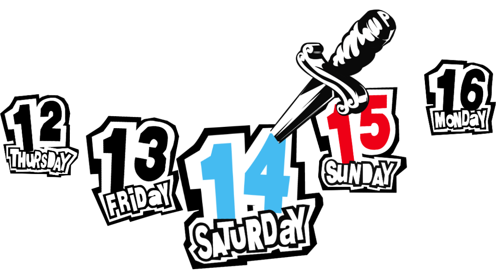
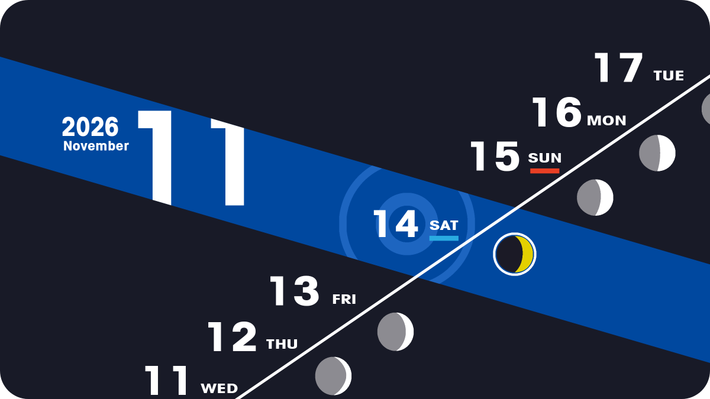

# Royal Calendar

An Android home-screen calendar with two styles: **Persona 5 / Royal** and
**Persona 3 Reload**. Today's date and neighbouring days, without KWGT.

[Download APK](https://github.com/M1ora/RoyalCalendar/releases/latest) ·
[Русский](README.ru.md)

## Calendar styles

### Persona 5 / Royal

The original calendar with Joker's dagger and a transparent background.

### Persona 3 Reload — new in 1.1.0

A diagonal calendar with a blue month ribbon and moon phases.
Choose a transparent or navy background and adjust corner rounding; the default is 30%.

## Install

Download **RoyalCalendar-v1.1.0.apk** from
[Releases](https://github.com/M1ora/RoyalCalendar/releases/latest), install it
on your phone, then open **Royal Calendar**, choose a style and tap
**Add to home screen**. Requires Android 8.0 or newer.

The widget starts at **5 × 2 cells**, with a **16:9** calendar image.
Hold it to move or resize it. An existing widget may retain its old size after
an update; resize it to two rows or add it again. Style settings apply to all
Royal Calendar widgets on the device.

On Android 12 or newer, enable **Alarms & reminders** using the app's
**Allow precise updates** button for the date to update at midnight.
Without this permission Android may delay the update.

Moon phases are calculated approximately from the date on your phone.
They work offline and do not require an API, location access or an internet connection.

## License and sources

Application code is licensed under [MIT](LICENSE).
Persona, Persona 5 / Royal, Persona 3 Reload and original game artwork belong
to their respective owners, including **ATLUS / SEGA**. This is an unofficial
fan project, not affiliated with or endorsed by them. Third-party artwork and
fonts are not relicensed under MIT; see [asset sources and notices](ASSETS.md).

Royal calendar assets: [Persona-5-Calendar](https://github.com/Mive82/Persona-5-Calendar).

For source builds and checks, see the [development guide](docs/DEVELOPMENT.md).
