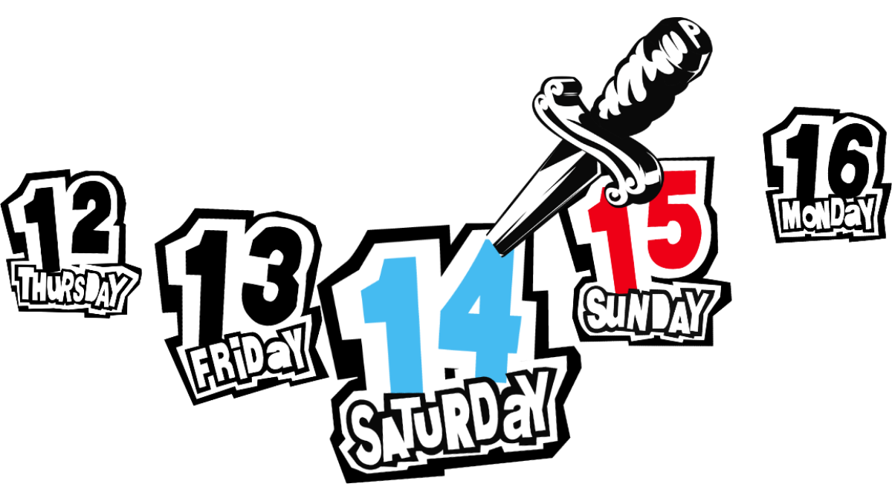
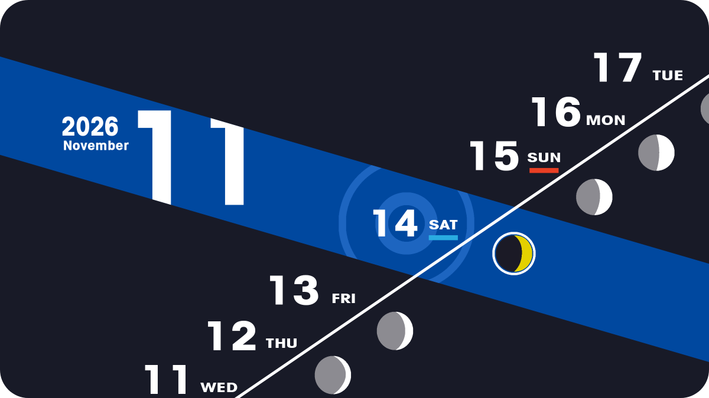

# Royal Calendar

Android-виджет календаря с двумя оформлениями: **Persona 5 / Royal** и
**Persona 3 Reload**. Сегодняшняя дата и соседние дни, без KWGT.

[Скачать APK](https://github.com/M1ora/RoyalCalendar/releases/latest) ·
[English](README.md)

## Оформления календаря

### Persona 5 / Royal

Календарь с кинжалом Джокера и прозрачным фоном.

### Persona 3 Reload — новое в 1.1.0

Диагональный календарь с синей полосой месяца и фазами Луны.
Прозрачный или тёмно-синий фон, настраиваемое скругление углов — по умолчанию 30%.

## Установка

Скачать **RoyalCalendar-v1.1.0.apk** из
[Releases](https://github.com/M1ora/RoyalCalendar/releases/latest),
установить на телефон, открыть **Royal Calendar**, выбрать оформление и нажать
**«Добавить на главный экран»**. Требуется Android 8.0 или новее.

Начальный размер виджета — **5 × 2 ячейки**, пропорции изображения — **16:9**.
Удерживать виджет для перемещения или изменения размера. После обновления уже
добавленный виджет может сохранить прежний размер — его можно уменьшить до
двух рядов или добавить заново. Выбранное оформление применяется ко всем
виджетам Royal Calendar на устройстве.

На Android 12 и новее для смены даты в полночь нажать в приложении
**«Разрешить точное обновление»** и включить **«Будильники и напоминания»**.
Без этого разрешения Android может задержать обновление.

Фазы Луны рассчитываются приблизительно по дате телефона.
Интернет, API и доступ к местоположению для них не требуются.

## Лицензия и источники

Код приложения — [MIT](LICENSE).
Persona, Persona 5 / Royal, Persona 3 Reload и оригинальная графика игр
принадлежат их правообладателям, включая **ATLUS / SEGA**. Это неофициальный
фан-проект, не связанный с ними и не одобренный ими. Сторонняя графика и шрифты
не перелицензируются под MIT; источники указаны в [ASSETS.md](ASSETS.md).

Ассеты календаря Royal: [Persona-5-Calendar](https://github.com/Mive82/Persona-5-Calendar).

Сборка из исходников и проверки описаны в [руководстве для разработки](docs/DEVELOPMENT.md).
